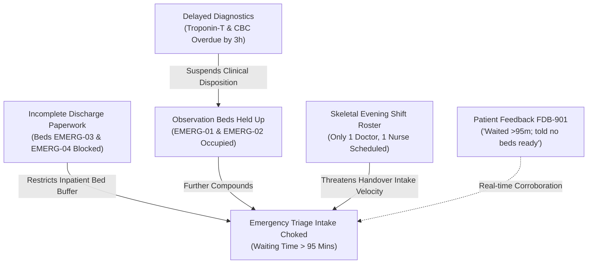

# FlowCare AI — Hospital Operations Intelligence & Bottleneck Resolution

> **Cypher 2026 Hackathon** | Challenge: **"The Blocked Bed"**  
> Fictional Demonstration Hospital: **Sanjeevani Multispeciality Hospital**  
> **Backend Service Only** (Python 3.11+ / FastAPI / Pydantic / Pytest)

---

## 🏥 Operational Challenge Overview

In acute multispeciality hospitals, bed congestion is rarely just a bed shortage problem—it is a cascading cross-domain operational bottleneck:
1. **Upstream Bed Blocks**: Inpatients who are clinically fit for discharge remain in hospital beds awaiting administrative clearance (Third-Party Administrator insurance billing approvals, physician discharge summary signatures, or take-home medication counseling).
2. **Intake Paralysis**: With emergency and observation beds physically blocked, newly arrived triage patients cannot be placed into care cubicles, causing emergency waiting times to surge.
3. **Delayed Diagnostic Decision-Making**: STAT lab and imaging reports face turnaround delays, preventing clinicians from deciding whether observation patients should be admitted or safely sent home.
4. **Shift Handover Deficits**: Imbalanced rostering leaves incoming shifts skeletal, creating a severe operational bottleneck.

**FlowCare AI** identifies these hospital operational bottlenecks, connects evidence across disparate hospital datasets, ranks issues transparently by urgency and impact, generates actionable recommendations, and queues simulated tasks for authorized staff review with an immutable audit log.

> **Clinical Safeguard Notice:** FlowCare AI is strictly an operational decision-support tool. It does **not** make clinical diagnoses, modify patient prescriptions, or execute automated real-world hospital actions.

---

## 🏗️ Architecture & Project Structure

The backend is organized for explainability and clean separation of concerns:

```text
backend/
├── main.py                          # FastAPI application, OpenAPI documentation, and route handlers
├── models.py                        # Pydantic data schemas for hospital entities, bottlenecks, & actions
├── requirements.txt                 # Core dependencies (FastAPI, Uvicorn, Pydantic, Pytest, HTTPX)
├── README.md                        # Documentation and demonstration guide
├── data/
│   └── synthetic_hospital_data.json # Fictional synthetic dataset for Sanjeevani Multispeciality Hospital
├── services/
│   ├── __init__.py
│   ├── data_service.py              # Repository manager & 8-category relational validation engine
│   ├── detection_service.py         # 8 transparent operational problem-detection engines
│   ├── priority_service.py          # Explainable urgency/impact operational scoring (0–100)
│   ├── causal_service.py            # Cross-domain root-cause causal reasoning engine
│   ├── recommendation_service.py    # Actionable operational recommendations generator
│   └── action_service.py            # Human-in-the-loop task review workflow & audit logging
└── tests/
    ├── __init__.py
    ├── test_data_service.py         # Data loading, filtering, & consistency checks
    ├── test_detection_service.py    # Verification of all 8 problem detection rules
    ├── test_causal_and_priority.py  # Cross-domain reasoning & priority formula tests
    ├── test_actions_and_audit.py    # Action review lifecycle & audit trail tests
    ├── test_api_endpoints.py        # Complete FastAPI endpoint & error handling tests
    └── test_sanjeevani_scenario.py  # End-to-end benchmark test for the Sanjeevani challenge scenario
```

---

## 📊 Eight Connected Synthetic Data Categories

All synthetic data is self-contained and reflects realistic operational workflows at Sanjeevani Multispeciality Hospital:

| Category | Key Fields | Operational Role |
| :--- | :--- | :--- |
| **A. Patients** | `patient_id`, `age_group`, `department`, `visit_type`, `status` | Patient intake and clinical track |
| **B. Appointments**| `appointment_id`, `doctor`, `department`, `datetime`, `status`, `waiting_time` | Outpatient & triage queues |
| **C. Beds** | `bed_id`, `ward`, `bed_type`, `occupancy`, `availability`, `admission_discharge_status`, `current_admission_id`, `blocked_reason` | Physical bed state (Occupied, Blocked, Available, Cleaning) |
| **D. Staff** | `staff_id`, `name`, `role`, `department`, `shift`, `availability`, `workload` | Shift coverage and workload stress |
| **E. Diagnostics** | `test_id`, `test`, `patient`, `department`, `status`, `requested_time`, `expected_completion` | Laboratory and radiology turnaround |
| **F. Admissions** | `admission_id`, `patient_id`, `admission_time`, `department`, `ward`, `bed_id`, `expected_discharge`, `status` | Inpatient stays linked to beds |
| **G. Discharge** | `discharge_id`, `admission_id`, `patient_id`, `request`, `pending_tasks`, `medication_status`, `document_status` | Administrative clearance tracking |
| **H. Feedback** | `feedback_id`, `complaint`, `category`, `severity`, `resolution_status`, `timestamp` | Real-time patient & family experience |

---

## 🔍 Eight Core Problem Detection Capabilities

1. **Unusually Long Waiting Times (`detect_long_waiting_times`)**  
   Compares measured wait times against department baselines (Emergency baseline: 30m, threshold: 45m). Detects average Emergency wait times exceeding 95 minutes.
2. **Bed Shortages, Idle Beds and Ward Mismatches (`detect_bed_bottlenecks`)**  
   Detects:
   - ICU saturation (100% capacity)
   - Beds physically blocked by incomplete paperwork (`EMERG-03`, `EMERG-04`)
   - Available General Ward beds remaining idle despite acute intake pressure (`GEN-05`, `GEN-09`)
3. **Doctor and Staff Workload Imbalance (`detect_staff_workload_imbalance`)**  
   Detects upcoming shift deficits (Emergency evening shift with only 1 doctor and 1 nurse) alongside low-workload outpatient clinics (Dermatology).
4. **Delayed Diagnostics (`detect_delayed_diagnostics`)**  
   Calculates exact turnaround delays from timestamps. Identifies overdue STAT Troponin-T (180 min delay), CBC, and CT Head scans holding up patient dispositions.
5. **Stuck Discharges (`detect_stuck_discharges`)**  
   Tracks discharge records with pending clearance tasks (e.g. TPA insurance approval, physician counter-signatures).
6. **Appointment Cancellations, No-Shows & Overloaded Slots (`detect_appointment_anomalies`)**  
   Flags overbooked consultation blocks (5 bookings in a 2-patient slot in Cardiology) and high cancellation/no-show clinics (100% non-attendance in Orthopedics).
7. **Operational Complaints (`detect_operational_complaints`)**  
   Gathers open, high-severity patient feedback citing long triage waits and delayed lab reports.
8. **Escalation Engine (`detect_escalations`)**  
   Identifies compounding multi-department crises (Emergency wait + bed block + late diagnostics + staffing deficit) triggering executive hospital alerts.

---

## 🧠 Root-Cause Cross-Domain Causal Reasoning

Rather than presenting isolated metrics, FlowCare AI connects operational signals into grounded causal links:



Every causal link provides:
- **Source Issue & Target Issue**
- **Concrete Supporting Evidence** (specific bed IDs, wait minutes, timestamps)
- **Plain-English Operational Explanation**
- **Confidence Rating** (`High`, `Medium`)
- **Documented Operational Uncertainty** (e.g., arrival surges, equipment throughput)

---

## 🎯 Priority Scoring Formula

The operational priority score ($0 - 100$) ranks issues so critical bottlenecks are addressed first:

$$\text{Priority Score} = \min(100, \max(0, \text{Urgency Points} + \text{Impact Points} + \text{Context Modifiers}))$$

- **Base Urgency**: `Critical` (40 pts), `High` (30 pts), `Medium` (20 pts), `Low` (10 pts)
- **Base Operational Impact**: `Critical` (40 pts), `High` (30 pts), `Medium` (20 pts), `Low` (10 pts)
- **Context Modifiers**:
  - Escalation Triggered / Multi-Domain Link: $+10\text{ pts}$
  - Severe Delay / Queue Multiplier: $+2\text{ to }+10\text{ pts}$
- **Level Mapping**:
  - $85 - 100$: **Critical**
  - $65 - 84$: **High**
  - $40 - 64$: **Medium**
  - $0 - 39$: **Low**

---

## ⚡ Simulated Actions & Human-in-the-Loop Review

Authorized demo operators can review recommendations and manage tasks:

```text
[Recommendation Generated] 
       ↓
[Simulated Action Created] → Status: "Awaiting review"
       ↓
[Operator Review (PATCH /actions/{id}/review)]
       ├── Status: "Approved" (Reviewer Label & Notes logged in Audit Log)
       └── Status: "Rejected" (Logged in Audit Log)
       ↓
[Completion (PATCH /actions/{id}/complete)] → Status: "Completed" (Logged in Audit Log)
```

Every transition is recorded in the immutable audit log (`/audit-log`).

---

## 🚀 Setup & Execution Instructions (Windows)

### 1. Prerequisites
- Python 3.11+ installed and on system `PATH`.
- PowerShell or Windows Command Prompt.

### 2. Navigate to Project Directory
```powershell
cd "C:\Users\Hemanth Rajkumar\OneDrive\Desktop\cypher\backend"
```

### 3. Create & Activate Virtual Environment
```powershell
python -m venv .venv
.\.venv\Scripts\Activate.ps1
```

### 4. Install Dependencies
```powershell
pip install -r requirements.txt
```

### 5. Launch the FastAPI Backend
```powershell
uvicorn main:app --reload --host 127.0.0.1 --port 8000
```

### 6. Interactive Documentation & Swagger UI
Once running, open your browser:
- **Interactive Swagger Docs:** [http://127.0.0.1:8000/docs](http://127.0.0.1:8000/docs)
- **Alternative ReDoc:** [http://127.0.0.1:8000/redoc](http://127.0.0.1:8000/redoc)
- **Health Endpoint:** [http://127.0.0.1:8000/health](http://127.0.0.1:8000/health)

---

## 🧪 Running Automated Tests

Run the full pytest suite with verbosity:

```powershell
.\.venv\Scripts\pytest -v
```

All **30 tests** pass in under 1 second, covering:
- Referential data integrity & state consistency
- Problem-detection engines for all 8 categories
- Sanjeevani multispeciality benchmark scenario
- Cross-domain causal link generation & evidence grounding
- Simulated action review lifecycle & audit trail
- API routes, query filtering, and 400/404 error validation

---

## 📋 API Endpoints Reference

### General
- `GET /health`: Health status and hospital metadata
- `GET /`: API capabilities overview and disclaimer
- `POST /demo/reset`: Resets synthetic data and simulated actions to initial state

### Data & Quality
- `GET /data-quality`: Comprehensive data consistency and integrity check
- `GET /data/overview`: Record counts across all 8 datasets
- `GET /data/patients`: Filter by `department`, `status`, `age_group`, `visit_type`
- `GET /data/appointments`: Filter by `department`, `doctor`, `status`
- `GET /data/beds`: Filter by `ward`, `bed_type`, `occupancy`, `availability`
- `GET /data/staff`: Filter by `department`, `shift`, `availability`, `role`
- `GET /data/diagnostics`: Filter by `status`, `department`, `patient`
- `GET /data/admissions`: Filter by `department`, `ward`, `status`
- `GET /data/discharges`: Filter by `request_status`, `document_status`
- `GET /data/feedback`: Filter by `category`, `severity`, `department`

### Operational Intelligence
- `GET /dashboard`: High-level KPI summary, bed metrics, and top priority items
- `GET /bottlenecks`: All detected operational bottlenecks ranked by priority score
- `GET /bottlenecks/{issue_id}`: Detailed bottleneck breakdown with evidence and possible causes
- `GET /causal-links`: Cross-domain causal links connecting evidence across datasets
- `GET /recommendations`: Actionable recommendations linked to active bottlenecks
- `GET /priority-queue`: Actionable queue ranked by priority score

### Simulated Actions & Audit
- `GET /actions`: List simulated actions (optional filter: `status`)
- `POST /actions`: Create a simulated action from a recommendation
- `PATCH /actions/{action_id}/review`: Approve or reject action (`{"status": "Approved", "reviewer_label": "...", "notes": "..."}`)
- `PATCH /actions/{action_id}/complete`: Complete an approved action (`{"reviewer_label": "...", "notes": "..."}`)
- `GET /audit-log`: Immutable chronological log of all action status transitions

---

## 🏆 Demonstration Scenario Walkthrough for Judges

1. **Open Swagger UI:** Navigate to `http://127.0.0.1:8000/docs`.
2. **Review Data Quality:** Execute `GET /data-quality` to demonstrate that all 8 datasets share clean referential integrity with zero orphaned IDs or inconsistent bed states.
3. **Inspect the Dashboard:** Execute `GET /dashboard` to show high-level metrics:
   - Total beds: 22, Occupied: 13, Blocked: 2, Available: 5.
   - Emergency wait times elevated, 3 overdue STAT lab tests.
4. **Inspect Bottlenecks:** Execute `GET /bottlenecks` to display the priority-ranked queue:
   - Systemic Emergency escalation ranked #1 (`Critical`, Score 100).
   - Inpatient discharge bed block (`EMERG-03`, `EMERG-04`) ranked #2.
   - Long Emergency wait times ranked #3.
5. **Demonstrate Root-Cause Causal Reasoning:** Execute `GET /causal-links`. Point out:
   - `LINK-BED-BLOCK-TO-EMERG-WAIT`: Demonstrates how blocked beds `EMERG-03` and `EMERG-04` directly constrain emergency triage intake.
   - `LINK-DIAG-DELAY-TO-BED-HOLD`: Demonstrates how overdue cardiac Troponin-T reports hold up patient dispositions in beds `EMERG-01` and `EMERG-02`.
6. **Review Actionable Recommendations:** Execute `GET /recommendations` to see practical suggestions (discharge task prioritization, diagnostic escalation, evening shift roster alert).
7. **Simulate Operator Review:**
   - Execute `GET /actions` to view pending tasks (`ACT-001`, `ACT-002`).
   - Execute `PATCH /actions/ACT-001/review` with `{"status": "Approved", "reviewer_label": "Dr. Sen, Shift In-Charge"}`.
   - Execute `PATCH /actions/ACT-001/complete` with `{"reviewer_label": "Discharge Liaison"}`.
8. **Verify Audit Trail:** Execute `GET /audit-log?action_id=ACT-001` to show the complete immutable record of who reviewed and completed the task.
